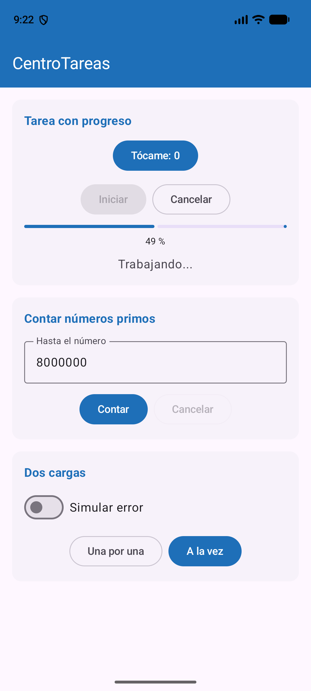
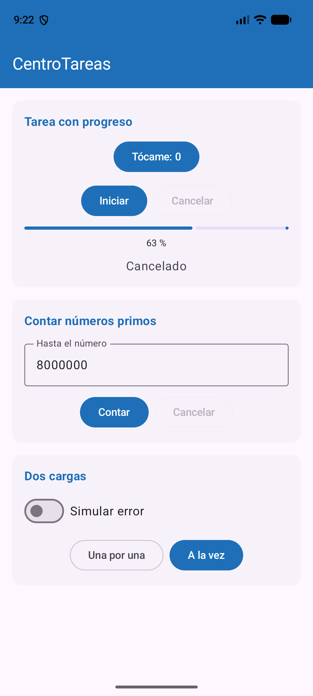
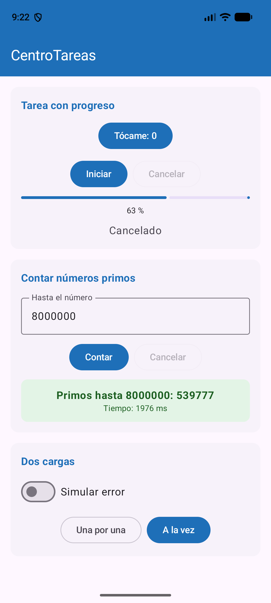
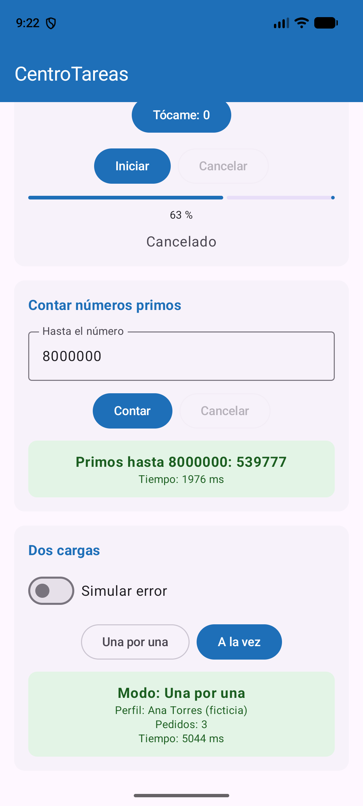
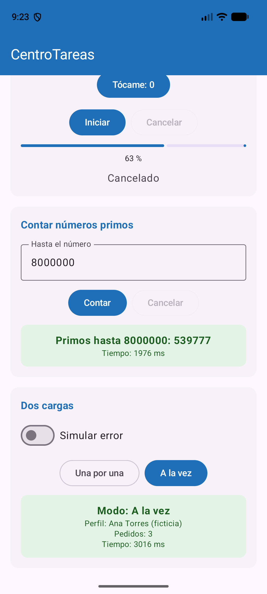
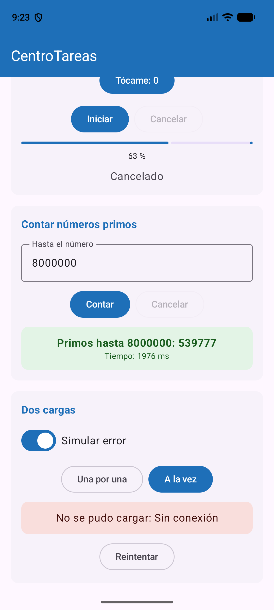

# CentroTareas

**Laboratorio 14 · Hilos en Android** · Programación en Móviles · Tecsup
**Alumno:** Lucas Inga Marín · **Docente:** Juan León S.

App Android que hace tres cosas que tardan sin congelar nunca la pantalla: una **tarea con barra de progreso** que se puede cancelar, un **cálculo pesado** (contar números primos) y **dos cargas de datos simuladas**, una por una contra a la vez. Primero se provoca el congelamiento a propósito (Paso 1) y después se resuelve con **corrutinas**. El botón **Tócame** es la prueba de vida: si deja de sumar, la pantalla está congelada.

Datos ficticios: perfil *Ana Torres (ficticia)*, que tarda 2 s, y pedidos 101, 102 y 103, que tardan 3 s.

## Tecnologías

- Kotlin 2.2.10 + Jetpack Compose + Material 3 (sin XML)
- Corrutinas: `viewModelScope`, `withContext`, `Job`, `async` / `await`, `coroutineScope`
- ViewModel + `StateFlow` (lifecycle 2.11.0)
- MVVM + Repository (interface)

## Estructura de paquetes

```
com.ingamarin.centrotareas/
├── MainActivity.kt
├── model/
│   └── Estados.kt                    PrimosUi, CargaUi
├── data/
│   ├── TareasRepository.kt           interface
│   └── TareasRepositoryLocal.kt      cargas simuladas y contarPrimos (Dispatchers.Default)
├── viewmodel/
│   ├── TareasViewModel.kt            tarea con progreso, primos y cargas
│   └── TareasViewModelFactory.kt
└── ui/
    ├── PantallaTareas.kt             las tres tarjetas
    └── theme/
```

## Arquitectura MVVM + Repository

```
View (PantallaTareas)
   | eventos: botones                    ^ collectAsStateWithLifecycle()
   v                                     |
ViewModel (TareasViewModel) --- StateFlow ---+
   | viewModelScope.launch { ... }
   v
TareasRepository (interface) ---> TareasRepositoryLocal
                                   (cargas simuladas con delay y contarPrimos)
```

| Capa | Conoce a | No hace |
|---|---|---|
| View (`ui/`) | Solo a su ViewModel | No lanza corrutinas ni usa `Thread`; solo muestra el estado y avisa los eventos |
| ViewModel | Solo a la interface del Repository | No conoce Composables, no recibe `Context` y no bloquea el hilo principal |
| Repository | Nada de la UI | No expone estados de pantalla; sus funciones `suspend` no bloquean el hilo desde el que se llaman |

En el código final **no** hay `GlobalScope`, `runBlocking` ni `Thread.sleep` (`git grep -- "*.kt"` no encuentra nada).

## Observación del Paso 1

Al pulsar **Tarea larga (MAL)**, `tareaLargaMala()` ejecuta `Thread.sleep(4000)` en el **hilo principal**.

- **Qué pasa con la pantalla:** se congela durante 4 segundos. El botón **Tócame** no suma aunque lo toques, nada se redibuja y la app no responde. Al terminar, aparece *Terminó* de golpe.
- **Por qué no se ve *Trabajando...*:** el mensaje sí cambia a *Trabajando...*, pero el hilo principal es el que dibuja la pantalla, y se queda dormido antes de poder redibujarla. Cuando despierta, el mensaje ya cambió a *Terminó*, así que *Trabajando...* nunca llega a pintarse.
- **Qué mostraría Android con una espera de 10 segundos:** un cuadro **ANR** (*Application Not Responding*): *"CentroTareas isn't responding"*, con las opciones **Close app** y **Wait**. Android lo muestra cuando la app no atiende un toque en unos 5 segundos. En la prueba apareció incluso con 4 segundos, porque se tocó **Tócame** varias veces mientras la pantalla estaba congelada.

## Capturas

| Tarea con progreso | Tarea cancelada | Contar primos |
|---|---|---|
|  |  |  |

| Una por una (≈5 s) | A la vez (≈3 s) | Error simulado |
|---|---|---|
|  |  |  |

> **Nota sobre el valor por defecto de los primos:** con 500 000 el cálculo tardaba unos 100 ms en este emulador y no se notaba que la pantalla seguía respondiendo. Como indica la guía, se ajustó el valor por defecto a **8 000 000**, que tarda unos 2 s (539 777 primos).

## Pruebas de aceptación

| Prueba | Resultado |
|---|---|
| Tarea larga: tocar Tócame mientras trabaja | ✅ El contador sigue sumando |
| Logcat con filtro HILO | ✅ `Antes: main`, `Dentro: DefaultDispatcher-worker-…`, `Despues: main` |
| Iniciar la tarea con progreso | ✅ La barra avanza de 0 a 100 % en ≈ 4 s |
| Cancelar a mitad | ✅ La barra se detiene, dice *Cancelado* y se puede iniciar otra vez |
| Pulsar Iniciar dos veces seguidas | ✅ No se lanzan dos tareas (botón deshabilitado y `if (corriendo) return`) |
| Primos hasta 1000 | ✅ 168 (100 → 25, 10 000 → 1229) |
| Primos con N grande | ✅ La pantalla no se congela y Cancelar funciona |
| Una por una | ✅ ≈ 5000 ms (5018 ms) |
| A la vez | ✅ ≈ 3000 ms (3013 ms) |
| Error simulado + Reintentar | ✅ Recuadro rojo; al desactivar el interruptor y reintentar, éxito |
| Rotar la pantalla durante la tarea | ✅ La tarea continúa y el progreso no se reinicia |
| Revisar el código | ✅ Sin `GlobalScope`, `runBlocking` ni `Thread.sleep` |

## Para pensar

**1. ¿Por qué no se veía *Trabajando...* en el Paso 1?**
Porque el hilo principal es el único que dibuja la pantalla. `tareaLargaMala()` cambia el mensaje a *Trabajando...* y enseguida duerme ese mismo hilo con `Thread.sleep(4000)`, así que no hay oportunidad de redibujar. Cuando despierta, el mensaje ya es *Terminó*, y eso es lo único que llega a pintarse.

**2. ¿Qué diferencia hay entre `Thread.sleep` y `delay`?**
`Thread.sleep` **bloquea el hilo**: nadie más puede usarlo mientras duerme (si es el principal, la app se congela). `delay` **suspende la corrutina**, no el hilo: el hilo queda libre para otras tareas (dibujar, atender toques) y la corrutina sigue cuando pasa el tiempo. Además, `delay` revisa la cancelación; `Thread.sleep` no.

**3. ¿Por qué `Dispatchers.Default` para los primos y `Dispatchers.IO` para la red?**
Contar primos usa mucho **procesador**: `Default` tiene tantos hilos como núcleos, pensado para cálculo. La red y el disco pasan casi todo el tiempo **esperando**: `IO` tiene muchos más hilos para que esas esperas no ocupen los hilos de cálculo.

**4. ¿Qué pasaría con la corrutina si el usuario cierra la pantalla? ¿Qué papel cumple `viewModelScope`?**
`viewModelScope` está atado a la vida del ViewModel: cuando el usuario cierra la pantalla de verdad, el ViewModel se destruye (`onCleared`) y todas sus corrutinas **se cancelan solas**, así no queda trabajo huérfano ni fugas de memoria. Al rotar, en cambio, el ViewModel sobrevive y la tarea continúa (por eso el progreso no se reinicia).

**5. ¿Por qué `async` tarda 3 s y no 5 s? ¿Qué pasa si una de las dos cargas falla?**
Porque con `async` las dos cargas corren **al mismo tiempo**: el total es el de la más lenta, máximo(2 s, 3 s) ≈ 3 s, en vez de la suma 2 + 3 = 5 s. Si una falla, `coroutineScope` **cancela la otra** y relanza la excepción; el `try/catch` del ViewModel la atrapa y muestra *No se pudo cargar: Sin conexión* con **Reintentar** (dejando pasar la `CancellationException`).
